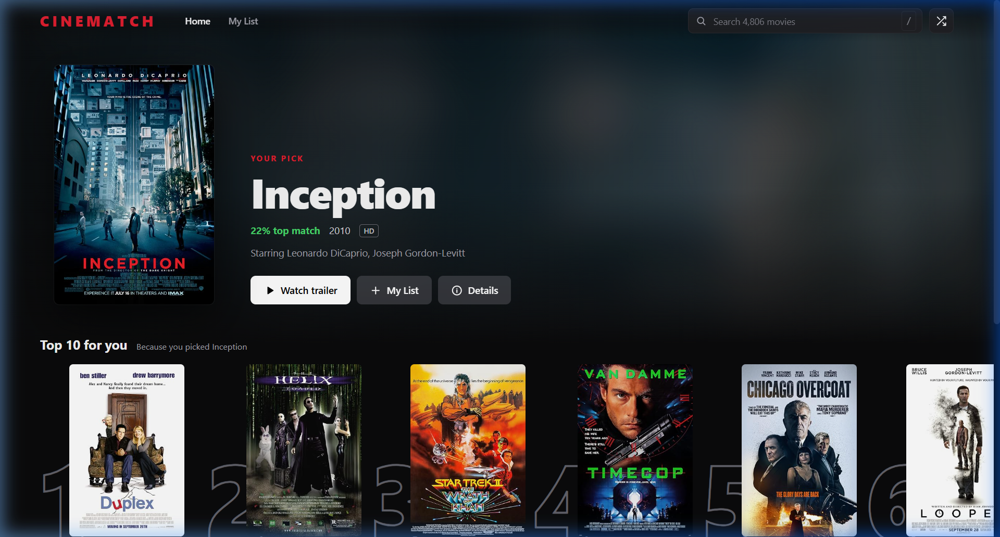

# 🎬 Week 10 — Content-Based Movie Recommendation System (CineMatch)

This directory contains the **Week 10** project and lab work for the Machine Learning course at SRM University AP.

---

## 🚀 Live Demo & Dedicated Repository

- **🌐 Live Web Application**: [cinematch.streamlit.app](https://cinematch-8jwpwrl9xuemkumaa6jf2n.streamlit.app/)
- **📦 Project Source Repository**: [aditya-forge/cinematch](https://github.com/aditya-forge/cinematch)
- **📓 Lab Notebook**: [`Week10_CineMatch_Movie_Recommender.ipynb`](Week10_CineMatch_Movie_Recommender.ipynb)



---

## 📝 Project Overview

**CineMatch** is an end-to-end content-based recommendation engine built on the TMDB 5000 movies dataset. It models semantic and thematic similarity across movie plots, genres, keywords, cast members, and directors using natural language processing and high-dimensional vector space modeling.

### Core Pipeline Highlights

| Stage | Techniques & Methodology |
|---|---|
| **Data Ingestion & Cleaning** | Merged TMDB movies (4,803 records) & credits datasets; parsed stringified JSON schemas (`ast.literal_eval`) for genres, keywords, cast, and directors. |
| **Feature Engineering** | Filtered top 3 lead actors, extracted director (`job == 'Director'`), collapsed whitespaces on entity names (e.g., `Sam Worthington` → `SamWorthington`) to avoid token collisions. |
| **Corpus Synthesis** | Synthesized unified textual tags: `tags = overview + genres + keywords + cast + crew`. |
| **Text Normalization** | Applied NLTK's **Porter Stemmer** to reduce inflectional forms to root bases (e.g., `activities` → `activ`). |
| **Vector Space Modeling** | **CountVectorizer** (`max_features=5000`, `stop_words='english'`), generating a $4806 \times 5000$ sparse term-frequency matrix. |
| **Similarity Metric** | Pairwise **Cosine Similarity** ($\cos(\theta) = \frac{\mathbf{A} \cdot \mathbf{B}}{\|\mathbf{A}\| \|\mathbf{B}\|}$) computing an angular distance matrix across all 4,806 titles. |
| **Runtime Architecture** | Deployed with Streamlit and an embedded zero-reload JavaScript Single Page Application (SPA), utilizing `@st.cache_data` and precomputed top-20 neighbor graphs (`recs.pkl`). |

---

## 📐 Machine Learning Pipeline Architecture

```
+-------------------------------------------------------------------------------+
|                               DATA INGESTION                                  |
|  tmdb_5000_movies.csv (4803 rows)   +   tmdb_5000_credits.csv (4803 rows)     |
+---------------------------------------+---------------------------------------+
                                        |
                                        v  Inner join on 'title' -> 4809 records
+-------------------------------------------------------------------------------+
|                             FEATURE SELECTION                                 |
|  Retained attributes: id, title, overview, genres, keywords, cast, crew       |
+---------------------------------------+---------------------------------------+
                                        |
                                        v
+-------------------------------------------------------------------------------+
|                            DATA PREPROCESSING                                 |
|  - JSON string parsing via ast.literal_eval                                   |
|  - Extract genre names and keyword strings                                    |
|  - Filter top 3 cast members (lead actors)                                    |
|  - Extract crew member where job == 'Director'                                |
|  - Whitespace collapse on entities (e.g. 'Sam Mendes' -> 'SamMendes')         |
|  - Tokenize plot overviews                                                    |
+---------------------------------------+---------------------------------------+
                                        |
                                        v
+-------------------------------------------------------------------------------+
|                              TAG CONSOLIDATION                                |
|  tags = overview + genres + keywords + cast + crew                            |
|  Lowercased text corpus per movie                                             |
+---------------------------------------+---------------------------------------+
                                        |
                                        v
+-------------------------------------------------------------------------------+
|                        STEMMING & VECTORIZATION                               |
|  - Porter Stemmer (NLTK) word root normalization                              |
|  - CountVectorizer (max_features=5000, stop_words='english')                  |
|  - Output: 4806 x 5000 sparse matrix                                          |
+---------------------------------------+---------------------------------------+
                                        |
                                        v
+-------------------------------------------------------------------------------+
|                          SIMILARITY COMPUTATION                               |
|  Cosine similarity across all vector pairs                                    |
|  Output: 4806 x 4806 symmetric distance matrix                                |
+---------------------------------------+---------------------------------------+
```

---

## 🛠️ Tech Stack

- **Language**: Python 3.9+
- **Machine Learning & NLP**: Scikit-Learn (`CountVectorizer`, `cosine_similarity`), NLTK (`PorterStemmer`), NumPy, Pandas
- **Frontend / Deployment**: Streamlit, HTML5/CSS3/JavaScript SPA, Docker
- **Environment**: Jupyter Notebook / Google Colab

---

## 🚀 Run in Colab

[](https://colab.research.google.com/github/aditya-forge/AdityaKumar_AP24110010333/blob/main/Week-10/Week10_CineMatch_Movie_Recommender.ipynb)
